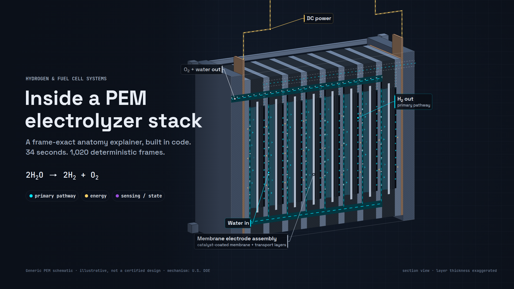

# PEM Electrolyzer Stack Anatomy

A code-driven, anatomy-style motion explainer of a generic proton exchange membrane (PEM) electrolyzer stack. It runs 34 seconds at 30 fps: 1,020 deterministic frames, indexed 0 to 1019, each one a pure function of its frame number.

**Live player:** https://mizcausevic-dev.github.io/pem-electrolyzer-stack-anatomy/
**MP4 (1920×1080, H.264):** [`public/media/pem-electrolyzer-explainer-Cursor.mp4`](public/media/pem-electrolyzer-explainer-Cursor.mp4)
**Article draft:** [`docs/medium-article-Cursor.md`](docs/medium-article-Cursor.md)



Vertical: Hydrogen & Fuel Cell Systems. Audience: engineers, technical buyers, educators and content teams who need a faithful picture of how a PEM stack works without a certified design behind it.

## What the 34 seconds show

Each chapter has one deliberate camera move and keeps the previous stage visible, so cause and effect never cut away.

| Frames | Time | Chapter | Camera move | Causal link carried forward |
| --- | --- | --- | --- | --- |
| 0–149 | 0–5 s | MEA and plates | 3/4 orbit while a section plane sweeps through the stack, then rotate square to the cut and push into one cell | The cut face stays in place for every later chapter |
| 150–299 | 5–10 s | Water feed | Drop to the anode inlet manifold, then rise with the water up one channel and through the porous transport layer | Wetted anode is where gas evolution starts |
| 300–509 | 10–17 s | Gas evolution | Pull back for DC power-on, push from 2.3× to 44× zoom into the catalyst layers, return to the channels | O₂ leaves with the circulating water that chapter 04 cools |
| 510–749 | 17–25 s | Cooling | Truck out to the water loop: heat exchanger, temperature sensors, trim valve | The same loop feeds the separators in chapter 05 |
| 750–1019 | 25–34 s | Balance of plant | Pull back to the complete system and reveal components in causal order, then hold | Final 60 frames hold a fixed camera and fixed labels |

Changed scale, slow motion and time compression are labeled on screen whenever they apply (`SCALE CHANGE`, `SLOW MOTION`, `TIME COMPRESSED`, `NOT TO SCALE`, `SECTION VIEW · NOT DISASSEMBLY`).

## Visual grammar

| Layer | Treatment | Example |
| --- | --- | --- |
| Hardware | Solid fill, 45° hatching on cut faces, dashed hidden lines | End plates, bipolar plates, frames |
| Field | Translucent gradient with dashed contours, tagged `FIELD` | Qualitative temperature field |
| Diagram | Boxed, gridded, monospace | Half-reaction panel, sensor key |

Accent colors are explanatory overlays, not literal emission: **cyan `#00E5FF`** primary pathway (water, H⁺, H₂), **gold `#FFD166`** energy or actuation (DC, heat, pump, valves), **violet `#9D4EDD`** sensing or state change (instrument tags, reaction sites). Oxygen uses a neutral tint so the by-product stays outside the accent system. Stage `#0B1019`, structure `#344257`.

## Accuracy and sources

Generic PEM configuration. No efficiency, output or performance claims, and no invented specifications.

| Claim on screen | Grade | Source |
| --- | --- | --- |
| Solid polymer electrolyte that passes only protons | Verified | [U.S. DOE, Hydrogen Production: Electrolysis](https://www.energy.gov/eere/fuelcells/hydrogen-production-electrolysis) |
| Anode `2H₂O → O₂ + 4H⁺ + 4e⁻`, cathode `4H⁺ + 4e⁻ → 2H₂` | Verified | Same DOE page |
| Electrons travel through the external circuit, driven by the applied DC voltage | Verified | Same DOE page |
| PEM electrolyzers typically operate at about 70–90 °C (the only physical value shown) | Verified | Same DOE page, attributed on screen |
| H₂ bubbles spawn at twice the O₂ rate | Derived | Stoichiometry of the DOE half-reactions |
| Material callouts marked "typ." (titanium PTL, iridium oxide anode, Pt on carbon cathode, carbon paper GDL) | Common practice, not from DOE | Verify before reuse |
| Electro-osmotic drag, heat from overpotentials and ohmic losses, balance-of-plant components | Common practice, shown qualitatively | Verify before reuse |
| Camera moves, palette, cutaways, layer thicknesses and timing | Illustrative choice | Original to this project |

Review status: consolidated working brief, not a certified engineering or medical reference. Verify subject-specific details before publication.

## Run it locally

Requires Node 22.18 or newer (the tests use Node's built-in TypeScript type stripping).

```bash
npm install
npm run dev          # player on http://localhost:4317
```

Player controls: Space plays or pauses, arrows step one frame, Shift+arrows step one second, 1 to 5 jump to a chapter, H toggles the overlay, F goes fullscreen. Deep-link any frame with `?frame=420`.

Render mode for capture: `?render&frame=420` draws a single frame at 1920×1080 with no chrome, `?render&frame=420&hud=0` drops the overlay, `?render&hero` draws the hero composition.

## Render stills, hero and MP4

Headless rendering drives the same `renderFrame()` the player uses, through Playwright and a local Chrome or Chromium (`CHROME_PATH` overrides the binary). The MP4 also needs `ffmpeg`.

```bash
npm run render:stills          # QA stills to .renders/stills/
npm run render:hero            # hero, 1200×630 social card and chapter stills to public/media/
npm run render:video           # full MP4 to public/media/
npm run bench                  # time renderFrame() for every frame
```

Measured on the build machine (4 vCPU Intel Xeon, headless Chrome, software canvas):

| Measurement | Result |
| --- | --- |
| `renderFrame()` per frame, three runs | mean 12.6–12.9 ms, p50 9.8–10 ms, p95 20.5–21.5 ms, max 46.6–47.2 ms (frame 498) |
| Full MP4 render (PNG capture + libx264 `-crf 20 -preset slow`) | 1,020 frames in 72.9 s |
| MP4 output | 1920×1080, 30 fps, 1,020 frames, 34.000 s, 18.96 MB |
| Production JS bundle | 58.15 kB (20.39 kB gzip) |
| Canvas calls per frame (recording context) | 1,523 (frame 0) to 66,892 (frame 383), mean 15,962 |

## Tests

```bash
npm test             # node --test, 15 tests
npm run typecheck
```

The tests check that chapter boundaries match the brief exactly, the camera has no cuts (bounded zoom, pan and rotation per frame), and the final two seconds hold a fixed camera and fixed annotation layer. They also hash every canvas call for sampled frames to prove that output depends only on the frame index, regardless of render order.

## Deploy to GitHub Pages

```bash
GH_TOKEN=<token with repo scope> npm run deploy:pages
```

`scripts/deploy-pages.mjs` builds, then refuses to publish if `dist/` contains anything outside an allowlist of web-servable file types. It then commits the build on top of the `gh-pages` branch as a normal fast-forward and pushes it. The token reaches git only through a credential helper that reads an environment variable. Last, the script polls the live URL until it serves the new bundle and confirms that source paths (`package.json`, `src/`, `scripts/`, `tests/`, `docs/`) return 404. `--verify-only` reruns just the live checks.

## Architecture

```
src/engine/
  constants.ts      format, chapter table, timecode
  camera.ts         keyframed camera (eased, log-space zoom), section plane, orthographic Projector
  geometry.ts       stack layout in illustrative world units
  render.ts         renderFrame(ctx, frame): the only entry point
  hero.ts           hero / social card composition
  scenes/
    exterior.ts     3D boxes, tie rods, ghost of the removed half
    section.ts      cut face with level-of-detail textures, focus-cell spotlight
    flows.ts        water, gas, electrons, temperature field
    micro.ts        catalyst-layer schematic and half-reaction diagram
    plant.ts        balance of plant and sensor tags
    labels.ts       chapter callouts
    hud.ts          captions, badges, legend, locator, chapter rail
src/main.ts         player UI and headless render hooks
scripts/            render.mjs (stills, hero, MP4, bench), deploy-pages.mjs
tests/              node --test suites
```

Determinism rules: no `Date`, no `performance.now()` inside the renderer, no unseeded randomness (textures come from `mulberry32` with fixed seeds), and no state carried between frames.

## Repurposing

The engine is subject-agnostic: a camera keyframe table, a section plane, a layer table and timed overlays.

- **PEM fuel cell stack:** same layer stack and plates, reverse reaction (H₂ + O₂ in, water, heat and DC out). Mostly a change to flow directions and captions.
- **Alkaline, AEM or solid oxide electrolyzers:** swap the layer table and the half-reactions on the same DOE page.
- **Other verticals:** battery cell anatomy, heat exchangers, filtration membranes, or any product where a sectional view plus a labeled flow path explains the value faster than a spec sheet.

## License

MIT © 2026 Kinetic Gain LLC. Illustrative schematic, not engineering, safety or design guidance.
